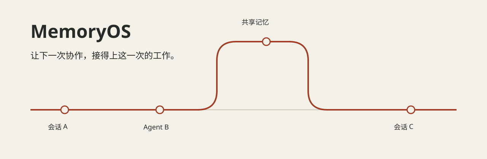

<div align="center">



# MemoryOS

### 让 AI 记住项目，让下一次协作接得上。

一个运行在本地的 **AI 共享记忆与协作工作台**。<br>
保存项目背景和经验，让不同 AI 助手查得到；<br>
把任务进展、笔记与依据放在一起，让人看得清、接得上、能回查。

[了解产品](https://wyxp600-wep.github.io/memoryos-public/) · [核心功能](#核心功能) · [开始使用](#开始使用) · [软件发行](https://github.com/wyxp600-wep/memoryos-public/releases) · [接入文档](docs/getting-started.md)

**跨 Agent 共享 · 长期记忆与任务检查点 · 任务接力 · 笔记图谱 · 可追溯治理**

</div>

## 为什么需要 MemoryOS？

你可能遇到过这些情况：昨天刚解释过的项目背景，今天又要说一遍；一位 AI 找到了问题，换另一位接手时却不知道查到哪了；明明解决过的故障，下次仍要翻聊天记录。

MemoryOS 把这些散落的信息保存为**能检索、能更新、能交接的工作资料**。AI 开工前可以查背景，遇到问题可以找经验，结束后可以留下结论和下一步。

这里的 **Agent** 就是能使用工具执行任务的 AI 助手；**MCP** 是它访问 MemoryOS 的接口。你使用已有的 AI 客户端，MemoryOS 提供共同的记忆与协作基础。

| 常见困扰 | 使用 MemoryOS 的方式 |
| --- | --- |
| 换一个 AI，就得重新交代背景 | 让已接入的 AI 查询同一项目的背景、约定和历史决策 |
| 任务太长，中断后不知道从哪里继续 | 留下任务检查点，写清已完成、阻碍和下一步 |
| 多个 AI 分工，进度和先后顺序对不上 | 在同一看板维护认领、依赖、阻塞与验收状态 |
| 经验散在聊天记录和笔记里 | 按问题检索，并回查完整正文与依据 |
| 旧经验过时了，却还在被引用 | 标记失效、检查冲突、归档并保留追溯记录 |

## 核心功能

### 01 · 让不同 AI 接着同一个项目工作

把项目背景、个人偏好、技术决策和踩坑经验保存到本地。接入同一记忆库的 Agent，可以通过 MCP 读取共同背景；按项目组织内容，减少不同工作的相互干扰。

例如：在一个客户端确认的接口约定，换到另一个客户端后仍可查回，不必再次从头解释。

### 02 · 找到结论，也能查清为什么

按问题检索相关记忆，再打开完整正文。当前实现结合关键词与向量检索，并支持附加原文证据和记录引用，方便回到当时的依据核实。

例如：查“这个接口为什么要重试”，不只看到处理办法，还能回查适用条件、原文引用和验证记录。

### 03 · 长任务中断后，留下明确的接续位置

长期经验与临时进度分开保存。工作记忆可记录当前目标、已完成事项、阻碍和下一步；关联任务的结构化检查点可跨新会话继续读取。

例如：排查到一半换会话，下一位能先看“已经排除什么、还有什么没验证”，减少重复尝试。

### 04 · 把分工、依赖和验收放到同一张看板

任务可以分派、认领、续租、标记阻塞、交回和完成；用依赖关系表达先后顺序。配置验收门的任务，完成前先检查验收条件。

例如：一位 Agent 修改接口，另一位在前置任务完成后补测试；交接时保留任务状态与证据。

### 05 · 让已有资料成为可检索的经验

从支持的本机明文来源读取记忆、规则和对话资料，进行去重检查；需要提炼的内容可交给配置好的 LLM 整理后入库。来源范围和提炼服务需要配置。

例如：把过去排查故障的长记录，整理成“什么情况下、采取什么行动、依据是什么”的经验条目。

### 06 · 让过时经验能够纠正，而不是一直被沿用

查看可能冲突的新旧结论、重复候选、待归档内容和使用情况。通过反馈标记有误或过时的记忆，保留追溯线索；疑似冲突需要核实处理。

例如：部署方式变了，可以标记旧方案已被替代，并保留当时为何采用它的记录。

### 07 · 把笔记、记忆和任务联系起来

支持 Obsidian 笔记库的增量导入、记忆导出，以及笔记内容和反向链接浏览；统一图谱把笔记、记忆与任务卡的关联放到一起查看。

例如：从一份项目笔记找到相关技术决策，再追到处理这项问题的任务卡。

### 08 · 把零散经验整理成可审查的操作方法

从已有记忆生成候选方法包，保留来源和适用条件，支持执行前预检及结果反馈。方法库的运行操作限于服务端允许的只读检查，生成文字不会直接变成执行授权。

例如：把多次连接排查的经验，整理成先检查配置、再验证连接、最后核对读写的排查步骤。

### 09 · 一处维护技能，分发到支持的工具

用中央技能目录管理 SKILL.md，向支持的客户端目录同步。相同内容跳过，发生替换时先备份；实际目标由本机配置和客户端能力决定。

例如：更新一份代码审查技能后，同步到 Codex、Claude Code 等已配置目标，减少手工复制。

### 10 · 在同一界面查看对话、步骤和结果

内置智能体对话和运行记录界面，可接入兼容的 LLM 服务，查看工具调用与输出。命令执行受权限和审批配置约束；需要你自行配置模型服务。

例如：围绕某项任务提问，查看它检索了哪些资料、调用了哪些工具，以及哪些操作还在等待批准。

### 11 · 让人能看懂系统现在处于什么状态

通过可视化界面管理记忆、任务、笔记、工具连接和治理信息，检查连接反馈、读写活动、运行健康及审计记录。不同客户端的连接检测覆盖范围可能不同。

例如：分清“客户端已配置”“实际连接成功”和“已经发生记忆读写”，排查接入问题更有依据。

## 特点与优势

| 特点 | 实现基础 | 对使用者的价值 |
| --- | --- | --- |
| 跨工具延续 | 通过 MCP 接入共同记忆库 | 更换支持 MCP 的客户端时，可以继续查询已有背景与进展。 |
| 经验与进度分开 | 长期知识加任务检查点 | 既保留可复用判断，也交代眼下做到哪里，减少交接信息混杂。 |
| 结果可回查 | 正文、证据、引用和审计记录 | 遇到重要结论时，能够追到依据，方便核验和纠错。 |
| 持续整理 | 冲突检查、失效反馈和归档机制 | 让记忆库有修正与维护入口，减少旧结论被反复沿用的风险。 |
| 本地掌握数据 | SQLite 本地持久化，提供导出与笔记同步 | 可以在自己的设备上保存和管理知识；外部服务调用另由配置决定。 |
| 人和 Agent 共用 | 工具接口加可视化工作台 | Agent 能调用工具，人能查看、管理和追踪同一份工作资料。 |

这些优势来自存储、检索、检查点和协作机制的组合。实际收益取决于记忆内容质量、客户端调用方式和配置，不承诺接入后自动消除重复工作或保证 AI 判断正确。

## 一次真实工作可以怎样接力？

下面是使用方式示例：

1. **开始排查**：让 Agent A 查项目背景与历史故障，记录本次复现步骤和已排除的原因。
2. **换人继续**：Agent B 读取同一任务的检查点，沿着已有证据实现修复，避免重复做已完成的排查。
3. **检查结果**：在看板查看状态，按任务约定验证结果，再保存本次修改的证据与结论。
4. **下次复用**：类似问题再次出现时，检索当时的方法和适用条件；发现条件变化，就修订或替代旧经验。

交接的重点不仅是“记得聊过什么”，还包括“现在要做什么、已经做到哪、凭什么判断完成”。

## 谁适合使用？

- **经常切换 AI 工具的开发者**：在支持 MCP 的客户端之间复用项目资料。
- **长期维护项目的个人或团队**：积累约定、故障经验和技术决策，持续修正旧知识。
- **让多个 Agent 分工的人**：对齐任务、依赖、进度和验收要求。
- **同时使用笔记和 AI 的知识工作者**：让已有笔记进入检索流程，并查看相关联的工作资料。

## 开始使用

### 使用桌面软件

前往 [Releases](https://github.com/wyxp600-wep/memoryos-public/releases) 查看实际已发布的 Windows x64 软件与版本说明。源码仓库和桌面软件是两种交付形式；桌面下载以发行页的实际附件为准。

使用本次便携包时，完整解压后双击 **`启动MemoryOS.cmd`**。该启动脚本仅在缺少本机配置时创建空配置，再调用原程序。不要单独移动 EXE；运行时与依赖需要保留相对位置。

打开软件后，配置自己的服务与数据目录，按接入说明连接 MCP 客户端，再用独立测试数据验证写入、搜索和回读。

### 从源码运行与配置 MCP

面向开发者的命令、MCP 配置和看板启动步骤保留在下面，也可直接阅读 [完整接入文档](docs/getting-started.md)。

<details>
<summary><strong>展开：源码启动、MCP 配置与管理看板</strong></summary>


本仓库提供当前开发状态的**源码发布快照**。建议先在独立数据目录试用。使用 Node.js **24 LTS** 与 npm；本次验证环境为 v24.18.1，依赖包含 `node:sqlite`。

```powershell
git clone https://github.com/wyxp600-wep/memoryos-public.git
cd memoryos-public/resources/memoryos
npm ci

# 只检查工具注册，不访问现有生产库，不下载嵌入模型。
New-Item -ItemType Directory -Force 'data' | Out-Null
$env:MEMORY_DB = Join-Path $PWD 'data/memory.db'
$env:MEMORYOS_DATA_DIR = Join-Path $PWD 'data'
$env:EMBED_MODE = 'fake'
node dist/server.js --list-tools
```

预期看到 `##TOOLS##` 开头的工具名称列表。`fake` 只用于检查运行管线，**没有真实语义检索能力**。正式使用选择 `local` 或 `api`。

### 接入支持 stdio 的 MCP 客户端

下例按 `C:/memoryos-public` 安装目录编写。替换为自己的绝对路径，并让需要共享记忆的客户端使用同一个 `MEMORY_DB`。不同客户端的配置入口可能不同。配置前先创建 `C:/memoryos-data` 目录（或你选择的数据目录）。

```json
{
  "mcpServers": {
    "memoryos": {
      "command": "node",
      "args": ["C:/memoryos-public/resources/memoryos/dist/server.js"],
      "env": {
        "MEMORY_DB": "C:/memoryos-data/memory.db",
        "MEMORYOS_DATA_DIR": "C:/memoryos-data",
        "MEMORY_AGENT": "my-agent",
        "EMBED_MODE": "local"
      }
    }
  }
}
```

`local` 首次加载可能下载模型，需要网络、磁盘空间和可用模型来源。API 嵌入需设置 `EMBED_MODE=api` 及 `EMBED_API_URL`、`EMBED_API_KEY`、`EMBED_MODEL`；密钥只放本机配置。写入受权限门禁约束，见[接入说明](docs/getting-started.md)。

### 打开管理看板

在上面的 PowerShell 会话中执行：

```powershell
$env:MEMORY_PORT = '8795'
node dist/dashboard.js
```

浏览器打开 `http://127.0.0.1:8795/`，首次鉴权见[接入说明](docs/getting-started.md)。服务默认仅监听本机；端口被占用时更换 `MEMORY_PORT`。按 `Ctrl+C` 停止。


</details>

## 使用前了解这几件事

**共享需要接入。** 不同客户端只有配置到同一个记忆库并调用相关工具，才能共享资料。MCP 接口本身不会让所有聊天自动同步，也不能保证每位 Agent 都按约定检索和沉淀。

**当前模型的职责是辅助检索。** BGE-M3 是集成的第三方嵌入模型，用来帮助匹配相近意思；它不是我们训练的聊天模型。MCP 共享记忆这个设计本身并不要求内置模型，但当前桌面版本启用了本地嵌入，尚不能直接删除模型当作完整的无模型版使用。采集提炼、内置智能体等功能另需配置相应 LLM 服务。

**本地保存不等于所有功能离线。** 记忆数据库保存在本机；选择外部 LLM 或嵌入服务时，相应请求内容会按配置发送给服务提供方。本地模型首次加载也可能需要下载。

**知识需要核实。** 记忆可以包含来源、适用条件、状态与证据，但保存、引用或生成方法不等于事实已经验证，也不意味着其他任务可以不加判断地照搬。

**执行和协作有边界。** 任务分派不等于客户端一定会启动；命令执行、写入和部分管理动作受运行模式、凭据及权限门禁控制。自动化程度取决于接入与配置。

## 开发者信息

| 位置 | 职责 |
| --- | --- |
| `resources/memoryos/dist/` | 手工维护的 JavaScript 内核源码：MCP、数据库、检索、任务与 HTTP 路由，无额外编译步骤 |
| `resources/memoryos/memoryos-dashboard-redesign/` | 可视化工作台前端 |
| `main.js`、`app/`、`window/`、`services/`、`security/` | Electron 桌面壳层源码 |
| `tests/` | 壳层测试 |
| `docs/` | 产品宣传页与接入文档 |

源码快照不包含个人记忆、数据库、会话、凭据、已安装依赖、模型、Electron 运行时与 `app.asar`，也不包含未纳入发布范围的 Android 与原生托盘源码。完整桌面软件的内容以相应发行说明为准。

在内核目录运行 `npm run lint` 检查语法，`npm test` 运行聚合冒烟。部分测试依赖模型、LLM 或特定环境；跳过不代表相应能力通过。请使用独立数据目录验证。

**授权说明**：当前未为自有代码指定开源许可证；公开可见不表示授予任意复制、修改或商用权利。第三方组件遵循各自许可证，见 [第三方说明](THIRD_PARTY_NOTICES.md)。

通过 [Issues](https://github.com/wyxp600-wep/memoryos-public/issues) 提供环境、复现步骤、预期与实际结果及脱敏日志。请勿上传数据库、令牌或 API Key。
