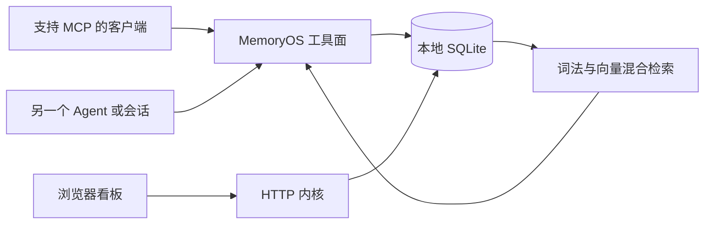

<div align="center">


# MemoryOS

### 换一个 Agent，工作不必从头开始。

为 AI 开发者准备的本地共享记忆与任务协作工作台。<br>
让项目背景、技术决策与任务进展，在不同会话和 MCP 客户端之间延续。

[产品介绍](https://wyxp600-wep.github.io/memoryos-public/) · [开始接入](#开始接入) · [接入文档](docs/getting-started.md) · [反馈问题](https://github.com/wyxp600-wep/memoryos-public/issues)

**MCP 接入 · SQLite 持久化 · 混合检索 · 协作看板**

</div>

---

## 你已经解释过的背景，值得被接着使用

在一个客户端里排查问题，换一个客户端实现方案，再开一个会话做验收——工具换了，项目没有换。MemoryOS 把这些工作背后的记忆与任务状态放在一个可查询的本地工作台里。

它面向需要长期维护项目、切换 AI 工具、协调多个 Agent 的开发者。

| 日常摩擦 | MemoryOS 提供的工作方式 |
| --- | --- |
| 每次开聊，都要重新解释项目背景 | 用 `memory_context` 获取项目上下文，再展开工作 |
| 结论散落在不同会话，想用时找不到 | 用 `memory_search` 检索，用 `memory_read` 回查正文 |
| 检索命中了，却不知道依据是什么 | 记录来源、证据与引用；保留追溯线索 |
| 多个 Agent 接力，任务进展难以对齐 | 用任务认领、续租、依赖与验收工具表达协作状态 |
| 记忆越积越多，需要持续整理 | 通过看板、反馈与治理流程检查冲突和失效内容 |

## 从一次对话，到下一次可用的上下文



**共享记忆。** 不同 MCP 客户端读写同一份数据库，按项目组织上下文，让不同会话访问共同背景。

**混合检索。** FTS5 词法检索与向量召回结合。嵌入可使用本地模型或外部兼容 API，按部署条件选择。

**可追溯知识。** 记忆支持来源、证据、状态与引用记录。引用表示被使用，不代表结论已获独立验证。

**任务接力。** 工具覆盖任务认领、续租、释放、阻塞、完成与验收；看板提供协作入口。并发边界取决于权限配置和执行环境。

**可视化管理。** 浏览器界面用于查看记忆、处理任务、配置连接和检查运行状态，同时保留面向 Agent 的工具接口。

## 开始接入

这是当前开发状态的**源码发布快照**。建议先在独立数据目录试用。使用 Node.js **24 LTS** 与 npm；本次验证环境为 v24.18.1，依赖包含 `node:sqlite`。

```powershell
git clone https://github.com/wyxp600-wep/memoryos-public.git
cd memoryos-public/resources/memoryos
npm ci

# 只检查工具注册，不访问现有生产库，不下载嵌入模型。
New-Item -ItemType Directory -Force 'data' | Out-Null
$env:MEMORY_DB = Join-Path $PWD 'data/memory.db'
$env:MEMORYOS_DATA_DIR = Join-Path $PWD 'data'
$env:EMBED_MODE = 'fake'
node dist/server.js --list-tools
```

预期看到 `##TOOLS##` 开头的工具名称列表。`fake` 只用于检查运行管线，**没有真实语义检索能力**。正式使用选择 `local` 或 `api`。

### 接入支持 stdio 的 MCP 客户端

下例按 `C:/memoryos-public` 安装目录编写。替换为自己的绝对路径，并让需要共享记忆的客户端使用同一个 `MEMORY_DB`。不同客户端的配置入口可能不同。配置前先创建 `C:/memoryos-data` 目录（或你选择的数据目录）。

```json
{
  "mcpServers": {
    "memoryos": {
      "command": "node",
      "args": ["C:/memoryos-public/resources/memoryos/dist/server.js"],
      "env": {
        "MEMORY_DB": "C:/memoryos-data/memory.db",
        "MEMORYOS_DATA_DIR": "C:/memoryos-data",
        "MEMORY_AGENT": "my-agent",
        "EMBED_MODE": "local"
      }
    }
  }
}
```

`local` 首次加载可能下载模型，需要网络、磁盘空间和可用模型来源。API 嵌入需设置 `EMBED_MODE=api` 及 `EMBED_API_URL`、`EMBED_API_KEY`、`EMBED_MODEL`；密钥只放本机配置。写入受权限门禁约束，见[接入说明](docs/getting-started.md)。

### 打开管理看板

在上面的 PowerShell 会话中执行：

```powershell
$env:MEMORY_PORT = '8795'
node dist/dashboard.js
```

浏览器打开 `http://127.0.0.1:8795/`，首次鉴权见[接入说明](docs/getting-started.md)。服务默认仅监听本机；端口被占用时更换 `MEMORY_PORT`。按 `Ctrl+C` 停止。

## 一种可实践的协作节奏

1. **开始前读上下文。** 获取项目背景，检索具体模块与历史问题。
2. **带依据地工作。** 回查记录和代码，区分历史结论与当前实测结果。
3. **把接力状态写清。** 用任务工具记录负责人、依赖和进展，保留证据与下一步。
4. **结束后留下可复用判断。** 写清适用条件、依据与行动，后续再检索和验证。

## 架构与边界

| 位置 | 职责 |
| --- | --- |
| `resources/memoryos/dist/` | 手工维护的 JavaScript 内核源码；MCP、数据库、检索与 HTTP 路由，无额外编译步骤 |
| `resources/memoryos/memoryos-dashboard-redesign/` | 看板前端与静态资源 |
| `main.js`、`app/`、`window/`、`services/`、`security/` | Electron 壳层源码，保留用于架构参考 |
| `tests/` | 壳层测试 |
| `docs/` | 宣传页与接入文档 |

- **存储在本地，网络行为取决于配置。** SQLite 文件在本机；外部嵌入、LLM 调用和模型下载可能访问网络，不能宣称所有运行模式均离线。
- **共享不等于自动接入。** 客户端需配置 MCP；读写与任务动作仍需相应工具调用和权限。
- **源码快照不等于完整桌面发行包。** 不含数据库、个人会话、凭据、依赖、模型、Electron 运行时、`app.asar`，也不含未纳入发布范围的 Android 与原生托盘模块。当前优先使用独立内核；桌面壳并非开箱即用。
- **授权范围。** 当前未为自有代码指定开源许可证；公开可见不表示授予任意复制、修改或商用权利。第三方组件遵循各自许可证，见[说明](THIRD_PARTY_NOTICES.md)。

## 验证与反馈

在内核目录运行 `npm run lint` 检查语法，`npm test` 运行聚合冒烟。部分测试需要模型、LLM 或特定环境；跳过不代表相应能力通过。请使用独立数据目录验证。

通过 [Issues](https://github.com/wyxp600-wep/memoryos-public/issues) 反馈时，请提供环境、复现步骤、预期与实际结果，以及脱敏日志。请勿上传数据库、令牌或 API Key。

**让下一次协作，接得上这一次的工作。**
